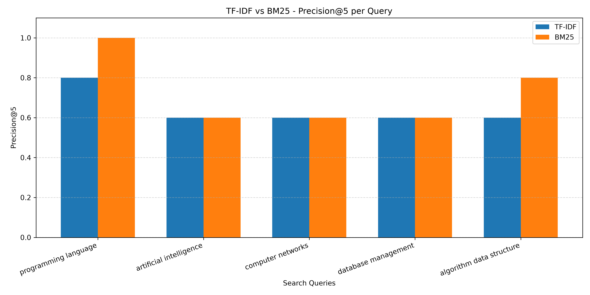
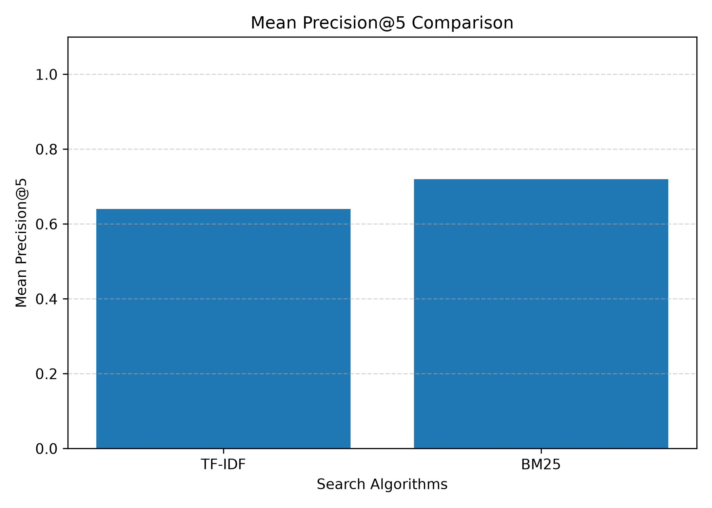

# Mini Search Engine: TF-IDF vs BM25

## 1. Project Overview

This project consists of developing a simple search engine for a collection of computer science documents.

The main objective is to implement and compare two information retrieval approaches:

- **TF-IDF (Term Frequency–Inverse Document Frequency)** combined with cosine similarity.
- **BM25 (Best Matching 25)**, a probabilistic ranking function.

The project evaluates the performance of both approaches using Precision@5 and compares their search results through data visualization.

It was developed as a practical learning project to explore information retrieval concepts and gain experience with Python and its data science libraries.

## 2. Project Objectives

The main objectives are:

- Build a small document collection.
- Implement text preprocessing techniques.
- Create a TF-IDF search index.
- Implement a BM25-based search system.
- Retrieve and rank relevant documents according to a user query.
- Evaluate search performance using Precision@5.
- Compare both algorithms through experimental results.
- Visualize the results using Matplotlib.

## 3. Technologies and Libraries

The project uses the following technologies:

| Technology | Purpose |
|---|---|
| Python | Main programming language |
| NumPy | Numerical operations |
| Pandas | Dataset loading and manipulation |
| Scikit-learn | TF-IDF vectorization and cosine similarity |
| rank-bm25 | BM25 implementation |
| Matplotlib | Data visualization |

## 4. Dataset

The search engine works with a collection of **30 computer science documents** stored in a CSV file.

The dataset contains three columns:

- `id`: Unique document identifier.
- `category`: Document category.
- `content`: Textual content of the document.

The documents are organized into five categories:

- Programming
- Artificial Intelligence
- Computer Networks
- Databases
- Algorithms

## 5. Project Architecture

The project is organized into the following structure:

```text
mini-search-engine/
│
├── data/
│   └── documents.csv
│
├── results/
│   ├── precision_comparison.png
│   └── mean_precision_comparison.png
│
├── src/
│   ├── preprocessing.py
│   ├── tfidf_search.py
│   ├── bm25_search.py
│   └── evaluation.py
│
├── experiments.py
├── requirements.txt
└── README.md
```

### Main modules

- `preprocessing.py`: Cleans and tokenizes text, removes punctuation and English stop words.
- `tfidf_search.py`: Builds the TF-IDF index and performs document retrieval using cosine similarity.
- `bm25_search.py`: Builds the BM25 index and ranks documents according to their relevance scores.
- `evaluation.py`: Implements Precision@5 and evaluates the search algorithms.
- `experiments.py`: Runs the experiments, compares the algorithms and generates visualizations.

## 6. Installation and Execution

### Prerequisites

- Python 3.10 or later.
- pip (Python package manager).

### Step 1: Clone the repository

```bash
git clone https://github.com/Massilia-Yazid/mini-search-engine.git
cd mini-search-engine
```

### Step 2: Create a virtual environment

```bash
python -m venv .venv
```

### Step 3: Activate the virtual environment

**Windows (PowerShell):**

```powershell
.\.venv\Scripts\Activate.ps1
```

**Linux / macOS:**

```bash
source .venv/bin/activate
```

### Step 4: Install dependencies

```bash
pip install -r requirements.txt
```

### Step 5: Run the experiments

```bash
python experiments.py
```

The program evaluates both search algorithms, displays their results and generates two comparison graphs in the `results/` directory.

## 7. Evaluation Method

The project uses **Precision@5** to evaluate the quality of the retrieved documents.

Precision@5 measures the proportion of relevant documents among the first five retrieved results.

The formula is:

\[
Precision@5 = \frac{\text{Relevant documents in top 5}}{5}
\]

Five search queries are used for the evaluation:

1. programming language
2. artificial intelligence
3. computer networks
4. database management
5. algorithm data structure

The relevant documents for each query are manually identified to evaluate the retrieval performance.

## 8. Experimental Results

The experiments produced the following results:

### Precision@5 per query

| Search Query | TF-IDF | BM25 |
|---|---:|---:|
| programming language | 0.80 | 1.00 |
| artificial intelligence | 0.60 | 0.60 |
| computer networks | 0.60 | 0.60 |
| database management | 0.60 | 0.60 |
| algorithm data structure | 0.60 | 0.80 |
| **Mean Precision@5** | **0.64** | **0.72** |

### Results interpretation

BM25 achieved a mean Precision@5 of **0.72**, compared with **0.64** for TF-IDF.

On this dataset and these five queries, BM25 performed better overall.

However, these results are specific to the small dataset and evaluation queries used in this project. They do not establish that BM25 is always better than TF-IDF.

## 9. Data Visualization

Matplotlib is used to generate two graphs:

**1. Precision@5 per query**

Compares the performance of TF-IDF and BM25 for each of the five search queries.



**2. Mean Precision@5 comparison**

Compares the average performance of both search algorithms.



The generated graphs are automatically saved in the `results/` directory.

## 10. Limitations and Future Improvements

This project is a small-scale implementation intended for learning and experimentation.

Possible improvements include:

- Expanding the document collection.
- Testing more search queries.
- Exploring additional evaluation metrics such as Recall@K and F1-score.
- Implementing a graphical user interface.
- Comparing additional information retrieval algorithms.
- Improving text preprocessing and ranking strategies.

## 11. Acknowledgements & AI Assistance

This project was developed as a personal learning experience with the assistance of ChatGPT (OpenAI).

As several concepts and technologies used in this project were new to me and had not yet been covered in depth in my university coursework, I used ChatGPT for technical guidance, explanations, code suggestions, debugging assistance and help understanding the implementation of certain algorithms and tools.

I actively participated in the development process, tested the implementation, examined the experimental results and worked to understand the code and the underlying concepts.

The main purpose of this project was not only to build a functional search engine, but also to discover new technologies, develop practical programming skills and deepen my understanding of information retrieval.

---

**Project status:** Completed – Initial implementation and experimental evaluation.